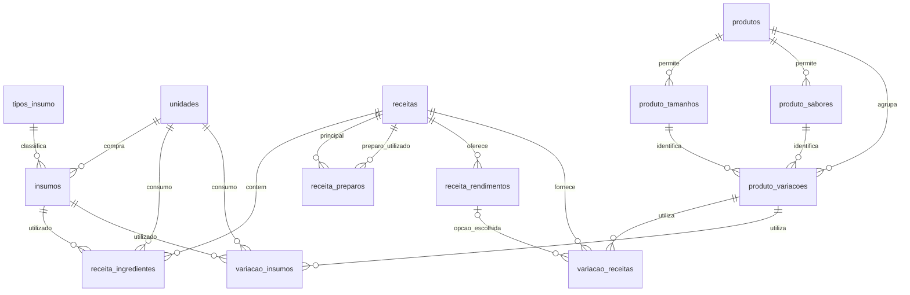

# Modelo de dados — Gestão de receitas e precificação

Data: 2026-10-06; atualização: 2026-10-31  
Versão: 0.15  
Estado: desenho de tabelas e relacionamentos aprovado em 2026-10-31; sem banco criado ou migração executada.  
Requisitos de referência: [spec.md](spec.md), versão 0.30. Contratos principais e desenho de 14 tabelas aprovados. Stack atual Java/Spring Boot; primeiro incremento migra somente catálogos/insumos. Demais tabelas e validações seguem suas entregas.

## Direção do desenho

Persistir entradas e relações no MySQL; calcular custos e preços sugeridos na API Java/Spring Boot. O preço praticado é um dado manual persistido. O desenho aprovado detalha a especificação e será validado no ambiente real na implementação.

A primeira versão usa tabelas relacionais, um produto agrupador e variações com composição própria. Manter ingredientes e preparos em tabelas separadas permite chaves estrangeiras diretas, sem referências polimórficas difíceis de validar. Configurações próprias ficam no produto e na variação; o padrão global ocupa uma linha de configuração.

Alternativas consideradas: uma tabela genérica para todos os componentes exigiria regras condicionais adicionais; persistir todos os custos calculados exigiria invalidar cada dependente após alterações. O desenho aprovado usa relações explícitas e custos calculados sob consulta. Não há código existente para reutilizar.

## Escopo da revisão aprovada

O desenho possui 14 tabelas, agrupadas em catálogos/insumos, receitas/componentes/rendimentos, produtos/opções/variações/composição e configuração global. Persistir as entradas originais e os vínculos; custos, preços sugeridos e indicadores são calculados com dados atuais conforme contratos aprovados.

Esta revisão completa a rastreabilidade dos 168 critérios e reconcilia versões, arquivamentos e resultados fora do limite com as decisões posteriores ao desenho inicial. O usuário aprovou o desenho de tabelas e relacionamentos em 2026-10-31. A escolha das versões/provedor, collation, DDL e mecanismo concreto das transações será concluída na preparação do primeiro incremento.

Backup/restauração completo deverá preservar o conjunto de dados e suas relações, conforme prioridade aprovada. Formato, ferramenta, destino concreto e procedimento serão desenhados separadamente. Importação futura não cria tabelas de staging, jobs ou histórico neste modelo por antecipação; necessidades dessas entregas serão revisadas no contrato correspondente.

## Visão dos relacionamentos

`configuracao_precificacao` é um padrão global e não precisa de FK em cada produto. A herança é resolvida pelo serviço de precificação.

## Convenções do desenho aprovado

- Tabelas e colunas em português sem acentos, usando `snake_case`.
- PKs `id BIGINT` positivo com incremento automático, mapeadas a Long em Java. Exceção: configuração global usa a identidade fixa 1, criada somente na configuração explícita do usuário.
- Engine InnoDB; texto `utf8mb4`. Collation a fixar na preparação do ambiente; regras de unicidade serão testadas com a collation escolhida.
- Cadastros principais: `criado_em DATETIME(6)`, `atualizado_em DATETIME(6)`, `arquivado_em DATETIME(6) NULL` e `versao BIGINT NOT NULL` iniciada em 1.
- Datas gravadas pela aplicação em UTC; interface converte para o fuso do usuário. `DATETIME` não guarda o fuso em si.
- `versao` é incrementada na mesma transação de edição; não é um `rowversion` gerado automaticamente pelo MySQL.
- Valores monetários de compra e venda: `DECIMAL(18,2)`. Quantidades, rendimentos e percentuais informados: `DECIMAL(18,6)`.
- Usar BigDecimal no Java, com DECIMAL128 nas divisões; calcular custos unitários e frações sem arredondar cada componente a centavos, conforme política numérica de contratos-api.md.
- Aceitar apenas valores dentro da precisão/escala do campo; rejeitar excesso de casas decimais ou overflow na API em vez de truncar silenciosamente.
- Limite físico de preço persistido: R$ 9.999.999.999.999.999,99. Quantidades e percentuais com até 12 dígitos inteiros e 6 fracionários. Esses são limites técnicos, não preços ou percentuais recomendados.
- Resultado sugerido também deve caber no limite monetário definido. Conforme contrato de precificação aprovado, valor arredondado acima do limite retorna precoSugerido null e pendência PRECO_SUGERIDO_FORA_DO_LIMITE com HTTP 200, preservando indicadores independentes disponíveis. Não é erro de validação retroativo da configuração. Overflow de operação decimal segue CALCULO_FORA_DO_LIMITE na precificação; outras operações preservam os códigos do seu contrato, como RESULTADO_FORA_DO_LIMITE na simulação de receita.
- Codes com conjunto fechado em `VARCHAR` e `CHECK`, em vez de `ENUM` do MySQL. Revisar a compatibilidade na versão selecionada antes de criar migrações.

Os tipos `DECIMAL` e mecanismos de FK/CHECK estão documentados no MySQL 8.4. Essa documentação serve de referência, sem fixar a versão do ambiente: [DECIMAL](https://dev.mysql.com/doc/refman/8.4/en/fixed-point-types.html), [FK](https://dev.mysql.com/doc/refman/8.4/en/create-table-foreign-keys.html), [CHECK](https://dev.mysql.com/doc/refman/8.4/en/create-table-check-constraints.html).

Na definição das constraints, combinar NOT NULL com CHECK conforme a nulabilidade do domínio. CHECK aceita expressão UNKNOWN além de TRUE; por isso, pares opcionais devem testar explicitamente IS NULL/IS NOT NULL para impedir preenchimento pela metade, conforme [documentação de CHECK](https://dev.mysql.com/doc/refman/8.4/en/create-table-check-constraints.html). O DDL e a compatibilidade com a versão/provedor selecionados ainda serão validados no banco real.

## Tabelas

### 1. `unidades`

Tabela de referência inicial, editada por migração, sem CRUD livre na primeira versão.

| Coluna | Tipo | Regra |
| --- | --- | --- |
| id | BIGINT | PK |
| codigo | VARCHAR(10) | Obrigatório e único: g, kg, ml, l, un |
| nome | VARCHAR(60) | Obrigatório |
| dimensao | VARCHAR(10) | MASSA, VOLUME ou UNIDADE |
| fator_base | DECIMAL(18,6) | Positivo; g/ml/un = 1, kg/l = 1000 |
| ativo | BOOLEAN | Define disponibilidade para novos usos; inicial true |

Conversão: `quantidade_base = quantidade × fator_base`. Somente unidades da mesma dimensão podem ser convertidas automaticamente. Conversão específica entre massa e unidade, por exemplo peso de um ovo, permanece extensão pendente; não criar tabela sem precisar definir esse comportamento.

Confirmado em 2026-10-19: a API recebe `unidadeCompraCodigo`; o backend consulta `unidades.codigo`, valida disponibilidade e persiste a FK interna. Código não é o nome exibido nem o id autoincremental. Códigos permanecem estáveis; não redefinir fator/dimensão de uma unidade em uso. Consulta de catálogos com ativo/inativo aprovada; manutenção por tela não faz parte desta etapa.

### 2. `insumos`

| Coluna | Tipo | Regra |
| --- | --- | --- |
| id | BIGINT | PK |
| nome | VARCHAR(150) | Obrigatório; nomes iguais não são chave de identidade |
| tipo_id | BIGINT | FK tipos_insumo; obrigatório |
| unidade_compra_id | BIGINT | FK unidades; obrigatório |
| quantidade_compra | DECIMAL(18,6) | Maior que zero |
| preco_compra | DECIMAL(18,2) NULL | Não negativo; NULL = preço ainda desconhecido |
| preco_atualizado_em | DATETIME(6) NULL | NULL enquanto nenhum preço tiver sido informado |
| campos comuns | Conforme convenções | Datas, arquivamento e versão |

Confirmado em 2026-10-19: permitir preço ausente, persistindo NULL. O custo unitário e os totais dependentes ficam indisponíveis, nunca equivalentes a custo zero. Campos/tipos deste desenho aprovados em 2026-10-31; mapeamento concreto será validado na implementação.

Nome obrigatório e quantidade de compra maior que zero confirmados. Preço negativo é inválido; zero é permitido com confirmação explícita aprovada: confirmarPrecoZero = true no cadastro. CHECK do banco aceita preço NULL ou não negativo; a confirmação pertence ao comando da API e não vira coluna do insumo. Zero confirmado recebe data de atualização e custo conhecido zero.

Não guardar custo por grama/ml/un como coluna. Exemplo: compra por R$ 40 de 1 kg equivale a R$ 0,04/g. Atualizar preço, quantidade ou unidade da compra de referência muda a base do custo; registrar esse instante em `preco_atualizado_em` quando o preço é conhecido, conforme edição aprovada. Edição apenas do nome preserva essa data. Exigir par coerente: preço conhecido tem data, preço ausente tem data NULL.

### 3. `receitas`

| Coluna | Tipo | Regra |
| --- | --- | --- |
| id | BIGINT | PK |
| nome | VARCHAR(150) | Obrigatório |
| observacoes | TEXT NULL | Modo de preparo / referências opcionais |
| campos comuns | Conforme convenções | Datas, arquivamento e versão |

Representa um lote base. Massa e recheio usam a mesma entidade. Não guardar custo nem percentuais de lucro na receita intermediária. Cadastro incompleto aprovado: permitir nome e composição vazia, com custo indisponível até completar; não requer estado persistido de publicação nesta etapa.

### 4. `receita_ingredientes`

| Coluna | Tipo | Regra |
| --- | --- | --- |
| id | BIGINT | PK |
| receita_id | BIGINT | FK receitas |
| insumo_id | BIGINT | FK insumos |
| quantidade | DECIMAL(18,6) | Maior que zero; por lote base |
| unidade_id | BIGINT | FK unidades; mesma dimensão da compra |
| ordem | INT | Não negativo; apresentação |

Permitir o mesmo insumo em várias linhas, pois pode aparecer em etapas distintas. O serviço soma todas as linhas. Validar dimensão na aplicação; FKs simples não validam essa relação entre tabelas.

### 5. `receita_preparos`

| Coluna | Tipo | Regra |
| --- | --- | --- |
| id | BIGINT | PK |
| receita_id | BIGINT | FK receitas; lote principal |
| preparo_id | BIGINT | FK receitas; receita utilizada |
| fracao_lote | DECIMAL(18,6) | Positiva; 0,5 = meio lote do preparo |
| ordem | INT | Não negativo |

Para esta etapa, receitas compostas utilizam fração do lote de outro preparo. Impedir `receita_id = preparo_id` com CHECK e ciclos indiretos no serviço. Se surgir necessidade de preparo consumido por unidade de rendimento dentro de uma receita, revisar este contrato antes de expandi-lo.

### 6. `receita_rendimentos`

| Coluna | Tipo | Regra |
| --- | --- | --- |
| id | BIGINT | PK |
| receita_id | BIGINT | FK receitas |
| nome | VARCHAR(100) | Ex.: Pequeno, Normal; único dentro da receita |
| descricao_porcao | VARCHAR(200) NULL | Dimensões ou referência de tamanho |
| quantidade | DECIMAL(18,6) | Maior que zero; unidades por lote inteiro |
| arquivado_em | DATETIME(6) NULL | Preservar opções já utilizadas |

Chave única `(receita_id, nome)`; chave candidata `(receita_id, id)` para FK composta de consumo. Um rendimento não precisa apontar para tamanho do produto: nomes/tamanhos comerciais e modo de cortar a receita são conceitos diferentes.

Mudar rendimento é edição explícita da receita e deve mostrar impacto em dependentes. Escalar produção é simulação, sem editar esses registros.

### 7. `produtos`

| Coluna | Tipo | Regra |
| --- | --- | --- |
| id | BIGINT | PK |
| nome | VARCHAR(150) | Ex.: Brownie recheado |
| descricao | TEXT NULL | Opcional |
| indiretos_percentual | DECIMAL(18,6) NULL | NULL herda global; zero é valor próprio |
| lucro_modo | VARCHAR(10) NULL | MARGEM ou ACRESCIMO; NULL herda global |
| lucro_percentual | DECIMAL(18,6) NULL | Par com lucro_modo |
| campos comuns | Conforme convenções | Datas, arquivamento e versão |

Regra de lucro é um par: modo e percentual são ambos NULL ou ambos preenchidos. Constraint prevista: permitir explicitamente o par ambos NULL ou exigir ambos IS NOT NULL com modo válido e percentual válido para esse modo. Não herdar modo de um nível e percentual de outro. Indiretos herdam independentemente do par de lucro; zero é valor próprio.

### 8–9. `produto_tamanhos` e `produto_sabores`

Cada tabela possui:

| Coluna | Tipo | Regra |
| --- | --- | --- |
| id | BIGINT | PK |
| produto_id | BIGINT | FK produtos |
| nome | VARCHAR(100) | Obrigatório; único dentro do produto |
| ordem | INT | Não negativo |
| arquivado_em | DATETIME(6) NULL | Preservar referências existentes |

Chaves únicas `(produto_id, nome)` e `(produto_id, id)`. Opções pertencem ao produto para não acoplar sabores de bolos a sabores de brownies. Para produto sem escolha real, usar opção explícita como Único/Tradicional, em vez de NULL na combinação.

### 10. `produto_variacoes`

| Coluna | Tipo | Regra |
| --- | --- | --- |
| id | BIGINT | PK |
| produto_id | BIGINT | FK produtos |
| tamanho_id | BIGINT | Obrigatório; tamanho do mesmo produto |
| sabor_id | BIGINT | Obrigatório; sabor do mesmo produto |
| preco_praticado | DECIMAL(18,2) NULL | Positivo quando informado |
| preco_praticado_atualizado_em | DATETIME(6) NULL | Par coerente com preço |
| indiretos_percentual | DECIMAL(18,6) NULL | NULL herda produto/global |
| lucro_modo | VARCHAR(10) NULL | MARGEM ou ACRESCIMO; NULL herda |
| lucro_percentual | DECIMAL(18,6) NULL | Par coerente com modo |
| campos comuns | Conforme convenções | Datas, arquivamento e versão |

Chave única `(produto_id, tamanho_id, sabor_id)` mesmo para variação arquivada: reativar/editar o cadastro existente em vez de criar duplicata. FKs compostas `(produto_id, tamanho_id)` e `(produto_id, sabor_id)` garantem que as opções pertencem ao produto. Não inserir automaticamente todas as combinações possíveis.

### 11. `variacao_receitas`

| Coluna | Tipo | Regra |
| --- | --- | --- |
| id | BIGINT | PK |
| variacao_id | BIGINT | FK produto_variacoes |
| receita_id | BIGINT | FK receitas |
| modo_consumo | VARCHAR(10) | UNIDADES ou FRACAO |
| rendimento_id | BIGINT NULL | Obrigatório apenas em UNIDADES |
| quantidade_receita | DECIMAL(18,6) | Positiva; unidades ou fração do lote conforme o modo |
| quantidade_produtos | DECIMAL(18,6) | Positiva; número de produtos atendidos pelo consumo |
| ordem | INT | Não negativo |

Guardar consumo e número de produtos separados preserva a relação original sem salvar uma divisão arredondada, especialmente 1/3. Exemplos:

| Uso | Modo | Rendimento | Quantidade receita | Quantidade produtos |
| --- | --- | --- | --- | --- |
| 1 brownie pequeno por produto | UNIDADES | Pequeno | 1 | 1 |
| Meia receita de recheio para 8 produtos | FRACAO | NULL | 0,5 | 8 |
| Uma receita de recheio para 3 produtos | FRACAO | NULL | 1 | 3 |

Em UNIDADES: `custo componente = custo lote × quantidade_receita / (rendimento × quantidade_produtos)`.

Em FRACAO: `custo componente = custo lote × quantidade_receita / quantidade_produtos`.

CHECK exige rendimento preenchido somente em UNIDADES. FK composta `(receita_id, rendimento_id)` referencia `(receita_id, id)` em receita_rendimentos para impedir uso do rendimento de outra receita. Quando rendimento_id é NULL, a FK receita_id mantém a receita válida.

### 12. `variacao_insumos`

| Coluna | Tipo | Regra |
| --- | --- | --- |
| id | BIGINT | PK |
| variacao_id | BIGINT | FK produto_variacoes |
| insumo_id | BIGINT | FK insumos |
| quantidade | DECIMAL(18,6) | Positiva; por unidade vendida |
| unidade_id | BIGINT | FK unidades; dimensão compatível |
| ordem | INT | Não negativo |

Permite embalagem, decoração e ingredientes diretos. Não vincular ao produto agrupador: cada variação pode ter embalagem própria.

### 13. `configuracao_precificacao`

| Coluna | Tipo | Regra |
| --- | --- | --- |
| id | BIGINT | PK; CHECK id = 1 |
| indiretos_percentual | DECIMAL(18,6) | Obrigatório e não negativo |
| lucro_modo | VARCHAR(10) | MARGEM ou ACRESCIMO |
| lucro_percentual | DECIMAL(18,6) | Obrigatório, validado pelo modo |
| atualizado_em | DATETIME(6) | UTC |
| versao | BIGINT | Concorrência otimista |

Sem padrão oculto de 30% ou 50%. Linha criada quando o usuário configura o aplicativo. Ausência da linha não impede cadastrar insumos/receitas; impede precificar uma variação que depende de valores globais ausentes. Uma variação com configurações completas próprias pode ser calculada.

### 14. `tipos_insumo`

| Coluna | Tipo | Regra |
| --- | --- | --- |
| id | BIGINT | PK |
| codigo | VARCHAR(30) | Obrigatório, único e estável |
| nome | VARCHAR(100) | Rótulo apresentado ao usuário |
| ativo | BOOLEAN | Disponível para novos cadastros; inicial true |

Valores iniciais: código INGREDIENTE/nome Ingrediente e código EMBALAGEM/nome Embalagem. Carga inicial por seed e consulta via API aprovadas no contrato de catálogos; sem tela de CRUD livre neste passo. O mecanismo concreto de migração/seed continua sujeito à preparação técnica. A classificação deixa de ser uma lista enum fixa no contrato de insumos. Novos tipos podem ser aceitos quando cadastrados/disponíveis, desde que não exijam regras especiais ainda não implementadas.

Expor `tipoCodigo`, resolver no banco e salvar `insumos.tipo_id`. FK com RESTRICT, sem apagar tipos referenciados. Proposta de desativação: impede novas associações, preserva leitura e atualização de preço dos insumos já vinculados. Mesma regra para unidades; não filtrar relacionamentos existentes ao calcular custos.

## Herança da precificação

Para indiretos: primeiro valor não NULL entre variação, produto e global.

Para lucro: primeiro par completo modo/percentual entre variação, produto e global. Guardar apenas o campo de lucro editado como fonte; derivar o equivalente na API.

Exemplo: global com indiretos 30% e margem 50%; produto com margem própria 40%; variação com indiretos próprios 0%. Resultado: indiretos 0% e margem 40%. Se a variação preencher lucro com ACRESCIMO 100%, a margem equivalente passa a 50%, sem alterar os outros níveis.

Validações: indiretos ≥ 0; MARGEM entre 0 e menos de 100; ACRESCIMO ≥ 0, limitado pela precisão física, sem teto de negócio de 100%. Preço praticado não altera esse par.

## Integridade, índices e ciclo de vida

Arquivamento/reativação de insumos, receitas, produtos e variações aprovados para a primeira versão, além das opções nos contratos de edição. Exclusão definitiva de insumos permanece evolução FUT-01; exclusão definitiva de receitas é FUT-02. Essas evoluções não incluem produtos. Políticas de dependências serão definidas nas versões futuras; não substituir FKs restritivas por cascata por antecipação.

- Criar índices nas FKs, inclusive nas referências inversas: `receita_preparos.preparo_id`, `receita_ingredientes.insumo_id`, `variacao_receitas.receita_id` e `variacao_insumos.insumo_id`. Isso permite descobrir usos e impactos sem varrer todas as composições.
- FKs de referências usam `ON DELETE RESTRICT`; remoção de linhas internas de composição será explícita e transacional. Não apagar um insumo usado e seus componentes por cascata.
- Arquivamento exclui cadastro da seleção para novos usos, mas não exclui linhas já referenciadas do cálculo. Ainda permitir corrigir preço de insumo arquivado se houver produtos dependentes.
- Edição de ingredientes, preparos e rendimentos usa a versão da receita. Opções, cabeçalho e personalizações do produto usam sua versão; criar variação também incrementa a versão do produto. A variação nova inicia versão 1.
- Edição de composição/preço, personalizações e ciclo de vida da variação usam sua própria versão. Alterar variação existente não incrementa versão/data do produto; o conjunto de combinações permanece preservado. Configuração global usa sua versão independente.
- Arquivar/reativar produto preserva estados, datas, versões, composição e preços dos descendentes; arquivar/reativar variação preserva composição, preço e data do preço. Opções omitidas de lista enviada são arquivadas sem remover vínculos. Não criar cascata de arquivamentos ou reativações.
- Produto arquivado bloqueia escrita nas variações, incluindo transições de ciclo de vida; consultas/cálculos continuam permitidos. Reativação preserva estados próprios dos filhos, sem exigir custo completo.
- Requisição de edição/transição compara versão esperada atomicamente. Diferenciar recurso ausente, conflito e comando sem efeito, conforme contrato da operação. Versão antiga nunca vira sucesso por coincidência de valores. Nos contratos que definem estado final idêntico com versão atual, preservar datas/versão. Não substituir versão do cliente por uma lida antes de salvar.
- Mudanças de custos ou configurações herdadas afetam os cálculos, sem regravar preço praticado ou versões dos dependentes. Rendimento fracionado é derivado; nenhum aviso ou simulação precisa de tabela de produção.
- Validação de ciclo precisa ser serializada nas mudanças do grafo: validar e inserir na mesma transação com bloqueio comum dessas edições. O mecanismo concreto será escolhido na implementação; concorrência otimista de uma receita isolada não impede um ciclo criado por duas receitas editadas juntas.
- Custos serão consultados em um snapshot consistente do banco por operação. Não misturar preço antigo do insumo com composição nova em consultas sequenciais sem transação de leitura adequada.
- Não usar filtros de arquivamento que ocultem componentes existentes; não deduplicar ingredientes de receitas por nome.

## Responsabilidade do banco e da aplicação

| Regra | Banco | Aplicação |
| --- | --- | --- |
| Registro referenciado existe | FK | Mensagem compreensível |
| Variação pertence a opções do mesmo produto | FK composta | Validar seleção antes de salvar |
| Rendimento pertence à receita escolhida | FK composta | Validar composição |
| Combinação tamanho/sabor única | UNIQUE | Tratar conflito inclusive em concorrência |
| Quantidades positivas, preços e percentuais válidos | NOT NULL/CHECK | Validar formato, escala e limites |
| Conversão de unidades compatíveis | Não resolvida por FK simples | Serviço de unidades |
| Ciclo indireto de receitas | Não resolvido por CHECK de linha | Validação do grafo em transação serializada |
| Custo indisponível | Não persistir total artificial | Propagar falta de preço/composição |
| Fórmulas e herança | Não persistir resultados derivados | Serviço de precificação |
| Avisos de margem/custo | Não persistir indicadores derivados | Resposta calculada da API |

## Exemplo de uso e cálculo

Dados fictícios, sem fixar o rendimento real do negócio:

1. Receita massa de brownie: custo de lote R$ 60, rendimento Pequeno 30 e Normal 20.
2. Receita recheio de ninho: custo de lote R$ 32.
3. Produto Brownie recheado: tamanho Pequeno e sabor Ninho.
4. Variação Pequeno/Ninho: massa em UNIDADES (1 para 1 produto); recheio em FRACAO (0,5 para 8 produtos); embalagem de R$ 1, consumo 1 un.
5. Configuração: indiretos 30%, modo MARGEM, percentual 50%.
6. Preço praticado da variação: R$ 15.

Custo direto = 60/30 + 32×0,5/8 + 1 = R$ 5. Custo total = R$ 6,50. Preço sugerido = R$ 13. Margem efetiva ≈ 56,67%.

Atualizar insumo para elevar lote do recheio a R$ 48 muda o custo direto para R$ 6, o total para R$ 7,80 e o sugerido para R$ 15,60. Preço praticado permanece R$ 15; margem efetiva 48%.

Nenhuma coluna de custo de receita/produto precisa ser atualizada: a próxima consulta usa as entradas atuais e retorna o cálculo novo. Otimização inicial: reutilizar resultado de cada receita apenas dentro da mesma operação de cálculo.

## Rastreabilidade

| Requisitos do spec | Estruturas / regras |
| --- | --- |
| INS-01 a INS-14 | tipos_insumo, unidades, insumos, data do preço, validações da criação, grafo e cálculo sob consulta |
| REC-01 a REC-07 | receitas, ingredientes, preparos, rendimentos, simulação e validação de ciclo |
| VAR-01 a VAR-05 | produtos, opções, variações, composição e UNIQUE |
| PRE-01 a PRE-09 | configuração global, overrides, par de lucro e serviço de precificação |
| VEN-01 a VEN-07 | preço manual na variação e indicadores calculados |
| CON-01 a CON-08 | consulta de insumos e filtros/paginação na API, incluindo arquivamento e preço ausente |
| EDI-01 a EDI-09 | edição parcial, versão esperada, referência de compra, data do preço e compatibilidade com usos |
| ARQ-01 a ARQ-07 | arquivado_em, versão e transações de transição/associação; relações existentes preservadas |
| CAT-01 a CAT-06 | tipos_insumo/unidades: códigos, nome, ativo, dimensão e fator_base; consultas de referência |
| RCP-01 a RCP-07 | receitas/ingredientes/preparos/rendimentos, transação de criação e custos derivados |
| SIM-01 a SIM-08 | cálculo de custos e simulação sem tabelas adicionais; leitura consistente e versão da receita |
| RCE-01 a RCE-08 | IDs de componentes e rendimentos, arquivado_em da opção, versão da receita e edição transacional |
| RLV-01 a RLV-09 | lista/cálculo filtrado na API, arquivado_em da receita e transições sem cascata sobre rendimentos |
| PRO-01 a PRO-06 | produtos, produto_tamanhos/produto_sabores, chaves únicas por produto e criação transacional |
| CVR-01 a CVR-08 | produto_variacoes/variacao_receitas/variacao_insumos; FKs compostas, unicidade e versão do produto |
| PRC-01 a PRC-14 | configuração global e pares próprios de produto/variação; herança, versões independentes, limites, indicadores e cálculo sob consulta |
| VRE-01 a VRE-10 | IDs estáveis das linhas da variação, remoção interna transacional, preço/data nullable e versão própria |
| PED-01 a PED-12 | produto/opções com pertencimento, unicidade por dimensão, arquivamento/reativação pelo ID e versão do agrupador |
| PLV-01 a PLV-14 | filtros/contagem por snapshot na API, estados individuais, transições sem cascata, guardas do pai e versões independentes |

Cobertura do desenho: 168 critérios referenciados por essas faixas, sem tarefas, código ou testes de implementação associados. Isso demonstra vínculo documental, não comprova constraints ou transações executadas.

## Risks & Concerns

Não há implementação existente para auditar. Pontos do próprio desenho:

| Ponto | Consequência | Mitigação |
| --- | --- | --- |
| Divisão salva como decimal curto | Frações como 1/3 perdem precisão desnecessariamente | Preservar numerador e denominador no consumo de produto |
| Custos persistidos duplicados | Dependentes ficam desatualizados | Calcular a partir das entradas atuais |
| Snapshot e ciclo concorrente | Mistura de versões ou grafo inválido | Transações, versão esperada e serialização das mudanças do grafo |
| Arquivamento filtrado em cálculo | Ingrediente desaparece e custo cai indevidamente | Consultar componentes existentes mesmo arquivados |
| Preparos com lucro próprio | Lucro e indiretos aplicados mais de uma vez | Transmitir só custo direto no preparo; precificar produto final |
| Taxas e impostos | Margem apresentada difere do resultado líquido real | Rotular como margem estimada pelos custos incluídos |
| Provedor/versão MySQL ainda não escolhido | Migração pode não corresponder ao ambiente | Fixar matriz de versões antes de gerar/executar DDL |

## Estado e próximo passo

Este desenho documenta colunas, tipos e integridade; não é SQL executado nem comprovação de comportamento do MySQL instalado. A validade das constraints e das transações será testada no banco real quando criarmos migrações.

Desenho de 14 tabelas e relacionamentos aprovado. Stack Java/Spring Boot/JPA confirmada; primeiro incremento em implementação para cadastro/consulta individual de insumos. Frontend e detalhes das entregas posteriores serão decididos antes dessas entregas. React/TypeScript/Vite permanece proposto; EF Core foi substituído por JPA.
